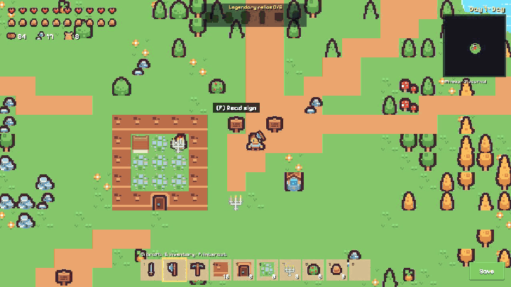
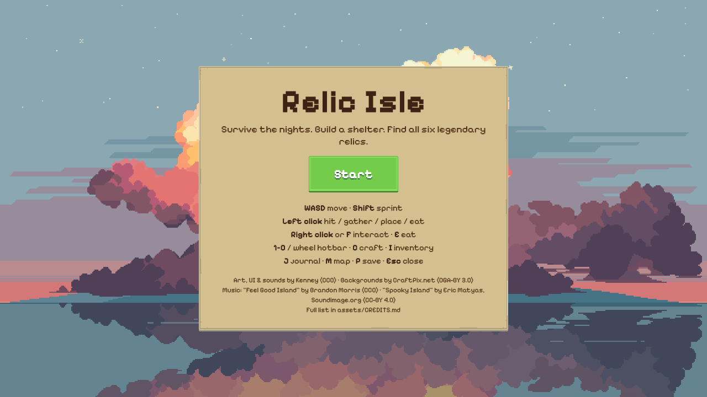
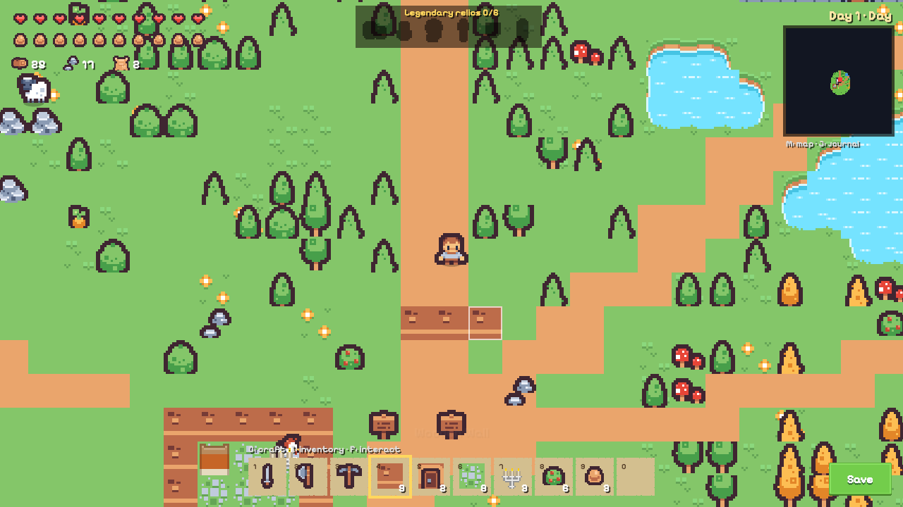
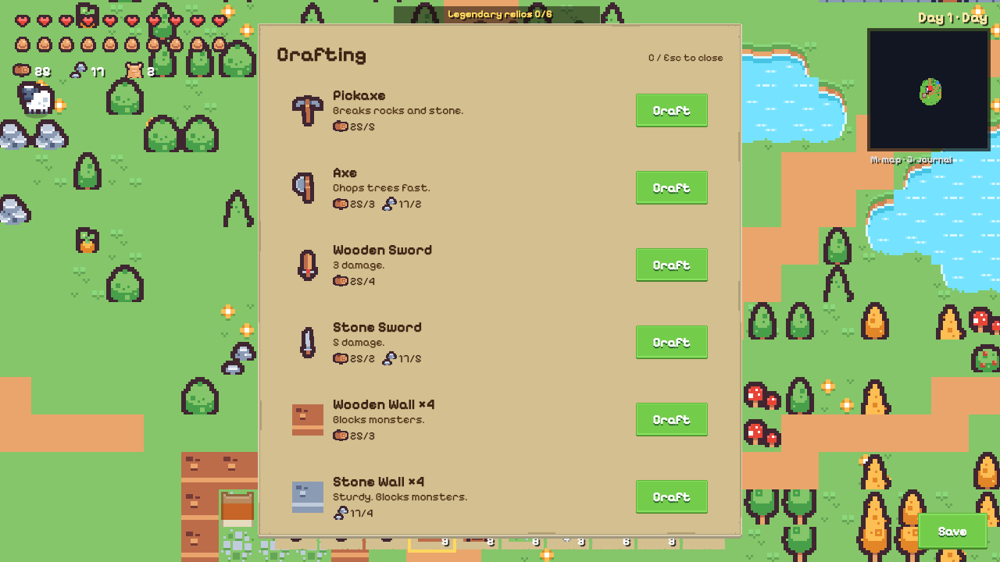
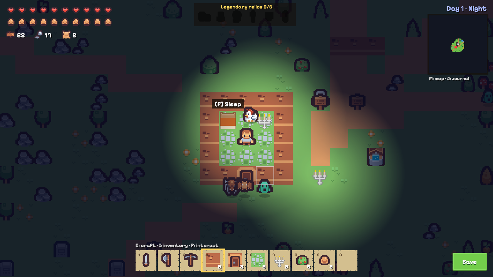
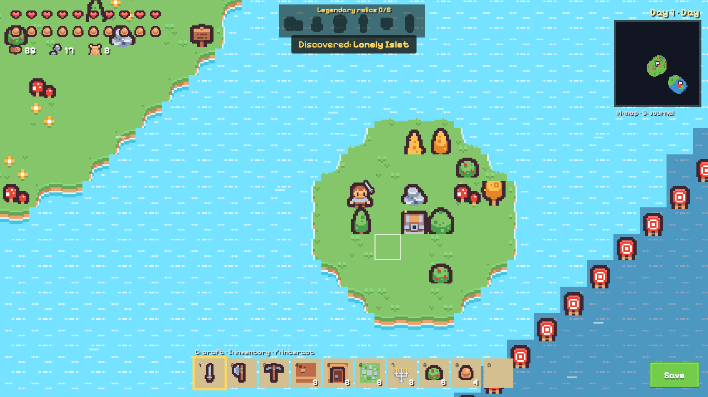
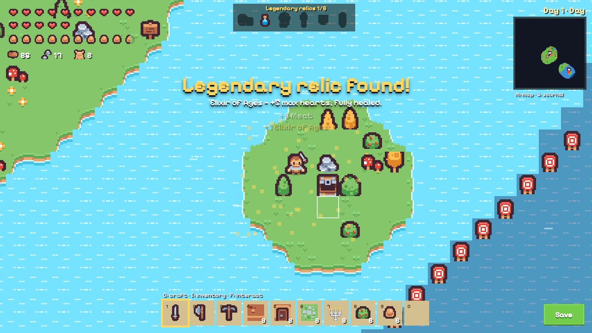
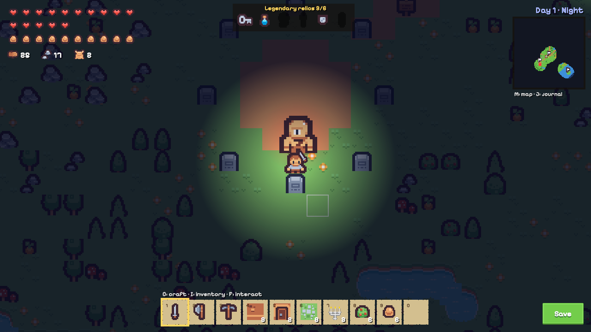
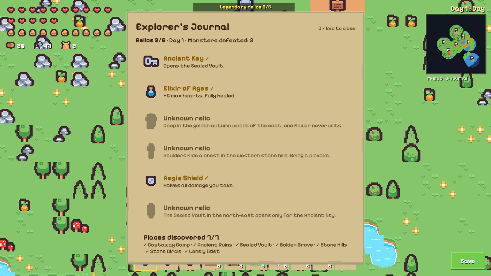

# Relic Isle

A top-down pixel-art survival game that runs in the browser. You're shipwrecked on a cursed island: gather resources, craft tools, build a shelter to survive monster-filled nights, and explore to find the **six legendary relics** that break the curse.

**▶ Play it here: https://bhavya8121-spy.github.io/relic-isle/**

No install needed. It runs in any modern desktop browser (Chrome, Edge, Firefox, Safari) with a keyboard and mouse.



<sub>Full-resolution recording: [media/gameplay.mp4](media/gameplay.mp4)</sub>

## Screenshots

| | |
|---|---|
|  **Title screen** |  **Gather resources and build** |
|  **Crafting** |  **Monsters come out at night. Your walls keep them out** |
|  **Swim inside the buoy line** |  **Find the six legendary relics** |
|  **The Cyclops of the Stone Circle** |  **Journal with relic clues** |

---

## Goal

Find all **six legendary relics** hidden around the island. You win the moment you hold all six.

Every relic has a clue in your **Journal (J)**:

| Relic | Where to look | What it does |
|---|---|---|
| Ancient Key | A chest in the **Ancient Ruins** (far north), guarded by imps | Opens the Sealed Vault |
| Sunblade | Inside the **Sealed Vault** (north-east). Needs the Ancient Key | Sword, 14 damage |
| Eternal Sunflower | A glowing flower in the **Golden Grove** (autumn woods, east) | Hunger drains half as fast |
| Storm Staff | A chest walled in by boulders in the **Stone Hills** (west). Needs a pickaxe | Click to call lightning (18 damage) |
| Elixir of Ages | A chest on the **Lonely Islet** off the south-east shore. Swim there | +5 max hearts, full heal |
| Aegis Shield | Dropped by the **Cyclops** that rises at the **Stone Circle** (south-west), only at night | Halves all damage you take |

Signs near the camp and at each landmark give extra hints. Chests holding relics sparkle gold.

## Controls

| Key / mouse | Action |
|---|---|
| **W A S D** or arrow keys | Move |
| **Shift** | Sprint (uses more hunger) |
| **Left click** (hold to repeat) | Attack, gather, place the selected block, or eat the selected food |
| **Right click** or **F** | Interact: open chests, read signs, sleep in a bed, unlock the vault |
| **Space** | Attack the nearest monster |
| **E** | Eat (the selected food, or your smallest snack) |
| **1 – 0** / mouse wheel | Choose a hotbar slot |
| **C** | Crafting menu |
| **I** or **Tab** | Inventory (click an item to put it in the selected hotbar slot) |
| **J** | Journal: relic clues, discovered places, stats |
| **M** | Island map (reveals as you explore) |
| **P** or the **Save** button | Save the game |
| **Esc** | Close menus |

## Rules of survival

**Health and hunger**
- You have **10 hearts** and **10 hunger points**.
- Hunger drains over time. It drains **faster when sprinting or swimming**.
- When you're well fed, hearts regenerate. At **zero hunger you starve**, losing a heart every few seconds.
- Eat berries, carrots, mushrooms (these also heal) or meat. Healing potions restore 6 hearts.

**Day and night**
- A full day lasts about 6 minutes.
- At **night**, slimes, spiders, bats and ghosts spawn and hunt you. At dawn they burn away.
- Imps guard the ruins and the vault at any time of day.

**Shelter**
- Monsters can't pass through **walls, fences or doors**. You can walk through doors.
- Monsters never spawn on **stone floors** or near **candle stands**.
- Sleep in a **bed** at night to skip to morning. It only works when no monsters are nearby, and the bed also becomes your respawn point.

**Water and boundaries**
- You can **swim** in any water inside the **buoy line**. Most land monsters can't follow you into water.
- The deep water past the buoys is **restricted**. The currents won't let you through.

**Death**
- If your hearts reach zero you respawn at your bed (or the starting camp).
- You keep your items.

**Gathering**
- Trees: bare hands are slow, an **axe** is fast.
- Rocks need a **pickaxe**. Small pebbles can be picked up by hand.
- Sheep give **wool** (needed for a bed). Animals give meat.

## Crafting recipes

| Item | Cost |
|---|---|
| Pickaxe | 5 wood |
| Axe | 3 wood, 2 stone |
| Wooden Sword (3 dmg) | 4 wood |
| Stone Sword (5 dmg) | 2 wood, 5 stone |
| Wooden Wall ×4 | 3 wood |
| Stone Wall ×4 | 4 stone |
| Door | 4 wood |
| Stone Floor ×4 | 2 stone |
| Fence ×4 | 2 wood |
| Bed | 6 wood, 3 wool |
| Candle Stand ×2 | 2 wood, 1 stone |
| Healing Potion | 3 berries, 2 mushrooms |

**Suggested start:** read the signs at camp → punch a few trees for wood → craft a **pickaxe** → mine stone → craft an **axe** and a **sword** → before the first night, build a small walled hut with a door, a floor and a candle → get 3 wool from sheep and craft a **bed**.

## Saving

- The game **autosaves** every 30 seconds, when you sleep, when you find a relic, and when you close the tab.
- Press **P** or click **Save** (bottom-right) to save any time.
- On the title screen, **Continue** loads your save. **New game** starts over and asks first, because it overwrites your save.
- Saves live in your browser's local storage. They stay on that browser and device, and clearing site data deletes them.

## Running it locally

The game is plain HTML, CSS and JavaScript with no build step. Browsers block audio loading from `file://`, so serve the folder with any static server:

```bash
cd relic-isle
python3 -m http.server 8080
```

Then open http://localhost:8080.

## Project layout

```
index.html          page, screens and menus
css/style.css       UI styling (Kenney 9-slice panels)
js/game.js          the whole game: world generation, survival, combat, crafting, saving
assets/
  sprites/          Kenney Tiny Town / Dungeon / Farm / Battle + Roguelike Indoor sheets
  backgrounds/      CraftPix pixel sea backgrounds (title, win, death screens)
  audio/music/      day and night music
  audio/sfx/        Kenney RPG + Interface sound effects
  ui/               Kenney Pixel UI panels and buttons
  CREDITS.md        every asset's source and license
media/              screenshots and gameplay recording for this README
```

## Credits

- Art, UI and sound effects by **Kenney** (www.kenney.nl), CC0.
- Backgrounds by **CraftPix.net**, OGA-BY 3.0.
- Day music: "Feel Good Island" by **Brandon Morris**, CC0.
- Night music: "Spooky Island" by **Eric Matyas**, Soundimage.org, CC-BY 4.0.

Full details, with links to every source, are in [assets/CREDITS.md](assets/CREDITS.md).
